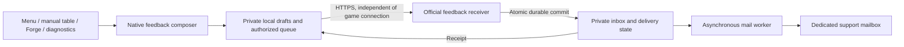

# Legacy private feedback contract

This document retains the private V1 contract for historical receipts and
self-hosted compatibility. New official feedback follows [public V2](public-feedback-v2.md)
and the [public privacy contract](privacy.md#in-app-feedback): exact public
preview, GitHub publication, native AI processing, client replies and removal.
No V1 record, private attachment or email is automatically made public.

V1 implemented a native composer, independent HTTPS receiver, durable private
inbox and asynchronous SMTP delivery. Its bounds below remain authoritative for
retained V1 records; they do not require keeping the mailbox workflow active in
an empty public V2 deployment. Already installed 3.0.0 packages retain their
disabled embedded feedback configuration.

The implementation is in `apps/client-qt/src/services/Feedback*`, the app-level
QML workflow and `apps/server/internal/feedback`, served by the independent
`hexproof-feedback` executable. Use [receiver operations](feedback-operations.md)
for configuration/deployment, [native development](autonomous-development.md)
for AI responsibilities and [the handoff](development-handoff.md) for current
activation and remaining capability limits.

## 1. Product scope

A player can describe a problem without leaving a game or creating another
account. They can deliberately attach a screenshot, an existing Forge crash
report, or hosting diagnostics. After submission, a receipt means that the
official receiver has durably stored the feedback. Maintainers receive private
email and can reply to the optional contact address.

Use the same flow for manual play, Forge, drafts, deck editing, installation
problems, and suggestions. It must work when the game WebSocket, current hub,
Forge process, or account login is unavailable. If the client itself crashes,
the user can resume a saved draft after restart; V1 does not capture native
client crashes or upload anything merely because a crash occurred.

V1 does not include an in-app conversation, public feedback board, votes,
automatic issue publication, or developer progress synchronization. The user
status ends at **Received**, not **Read**, **Confirmed bug**, or **Resolved**.
Descriptions and screenshots can contain private information: the entire
submission is support-private, including otherwise sanitized diagnostics.

## 2. Architecture and boundaries



- The Qt/QML/C++ `FeedbackService` and native composer/history connect to
  `apps/server/cmd/hexproof-feedback`, with cohesive
  `internal/feedback` storage, HTTP, validation, and delivery components.
- Run the receiver as a separate small service with its own OS identity and
  data directory. It needs neither game/account storage nor Forge processes.
  It lives in the existing Go module; V1 needs no database, web client, or
  third-party ticket service. Use a tested single-writer file store.
- Keep feedback independent of `WsClient`, the game wire protocol and its
  admission handshake. Feedback has its own schema compatibility policy;
  retained receipts remain readable independently of game compatibility.
- Keep private V1 storage/email delivery separate from public V2 publication.
  There is one authoritative receipt per submission, and no automatic conversion
  of a private report into public content.

## 3. Native experience

### Entry points and composer

Expose **Feedback** in the main menu and both table action menus. Make the
same action available from non-table screens through the existing application
navigation. Forge report details offer **Report this problem**; hosting
diagnostics offer **Send feedback with these diagnostics**. These explicit
contextual actions add a visible snapshot to the composer, never submit it.

Use one app-level composer in `Main.qml`. It must not leave a room, navigate
away from a draft, reset game state, or change smart-priority settings.
An app-level `feedbackInteractionOpen` covers the composer, history, previews
and native attachment picker. Feed it into the existing manual/Forge modal
input gates throughout that lifecycle, blocking game shortcuts and click-through
even when focus moves between windows. Preserve existing modal priority behavior:
local automatic passing is blocked by the existing gate; do not publish a new
hold or change priority preferences. Server-side eligible passing and game
clocks can continue. A table hint says the game is not paused. Closing saves
the draft and restores focus to the current valid screen, not a destroyed
control or a room that has since ended/disconnected.

Illustrative layout, not a rendered GUI:

```text
反馈                                              我的反馈   关闭
类型  [问题 ▾]       场景：Forge / EDH

发生了什么？ *
[描述问题；方便的话，也写一下操作步骤和预期结果。        ]

联系邮箱（选填） [                                     ]
附件  [添加图片] [选择崩溃报告] [添加托管诊断]
      Forge 崩溃报告 · 采集时间 · 版本        [查看] [移除]
      screenshot.png                        [预览] [移除]

将发送至 Hexproof 官方支持。描述和图片可能含私人信息。
技术信息 [展开查看]                       发送后联网时自动重试
草稿保存在本机，删除前保留                        [发送反馈]
```

Only the description is required. Category is `problem`, `suggestion`, or
`other`, defaulting to `problem`. Contact email and attachments are optional.
Keep reproduction steps within the description in V1, with helpful placeholder
text rather than many required fields. Show the full selected attachments and
technical metadata before Send, with preview/removal and the actual recipient
organization. Do not present the current custom game hub as the recipient.

If a draft is already open, another entry point offers to add its context to
that draft or create a new one; it never overwrites text. A new crash while
editing offers an attachment without adding it silently. A newer report
revision can be selected explicitly; it never replaces a frozen submission.

### Local lifecycle

| State / UI label | Meaning and available action |
| --- | --- |
| Draft / 草稿 | Editable, never authorized for transmission; save, export, delete. |
| Queued / 待发送 | Send was pressed; immutable content is saved and authorized for retry. |
| Sending / 正在发送 | An attempt is in progress; closing the window does not cancel it. |
| Unconfirmed / 结果待确认 | A request may have reached the receiver; query its receipt before retrying. |
| Received / 已收到 | Receiver acknowledged durable storage; show receipt and accepted time. |
| Needs attention / 需要处理 | Invalid content, unsupported schema, retry budget exhausted, or sending stopped; keep content and explain the next action. |

Persist the frozen body, attachment bytes, destination, submission ID, and
secret **before the first network attempt**. Refuse to start if this save
fails. Draft autosave failures remain visible; never show **Draft saved** when
storage failed. Use a dedicated single background I/O lane and image processing
so large feedback payloads do not stall game rendering. Stop and local deletion
commit a small private revocation/deletion journal before acknowledging the
action; recovery checks these journals before considering a stale authorized
record.

Keep local `draftCreatedAt` separately. The wire `createdAt` is the time of this
explicit Send/freeze, even for a much older draft; retries never refresh it.
Diagnostic capture times and problem-time versions are independent.

Ordinary disconnects retry with exponential backoff and jitter, starting at
5 seconds and capped at 6 hours; honor `Retry-After`. Allow at most 20 upload
attempts and 7 days from freezing. An uncertain twentieth upload can still use
the separate receipt-query budget; an absent receipt cannot authorize a
twenty-first upload. Resume on app startup/network recovery
within that budget, with jitter; restarting the app does not reset the budget.
No separate background process sends after Hexproof exits. A small bounded
receipt-query budget is tracked separately so querying does not exhaust uploads.

Before dispatch, **Stop sending** can return a queued item to a draft. After
dispatch, it stops future uploads but does not recall anything; retain the
unconfirmed state and offer receipt lookup. Process death during Sending also
recovers as Unconfirmed. Editing frozen content creates a new draft and only
a new explicit Send creates another submission; warn if the original may
already have been received. Never silently generate a new ID to fix a timeout.

Persist upload authorization separately from delivery state. Stop durably
revokes it under the same per-record synchronization as dispatch. Neither
restart, network recovery nor a GET returning 404 may reauthorize a stopped
upload. After Stop, receipt queries require an explicit user action; requests
already handed to the network may still have reached the receiver.

History lists category, a short description, time, state, and receipt, with
view, copy receipt, export, and delete-local-record actions. Export contains
only user-visible content and selected attachments, never the access secret.
Deleting local history does not delete server or mailbox copies. Deleting an
unconfirmed item explains that it might already have reached official support.
Deletion first applies the synchronized Stop transition and cancels remaining
local work; late responses cannot recreate deleted content. There are no
subsequent automatic queries for a deleted record.

## 4. Content and privacy

### Metadata

Capture a bounded allowlist when the draft/context is created: application
version, OS family, architecture, UI language, feature, and, when relevant,
game mode/format, priority mode, catalog version and runtime identity. Omit
unknown fields. Keep report-time versions within diagnostic snapshots; do not
rewrite old evidence to the version running when it is finally uploaded.

Do not add account IDs, player names, room IDs, hub URLs/IPs, deck lists,
hands, chat, raw game snapshots, action payloads, filesystem paths, access
codes, or authentication tokens to automatic metadata. No account association
is needed, even for signed-in users. User-provided text and images may contain
those details, so the preview must not promise that a whole submission has
been anonymized.

### Attachments

- **Forge crash:** copy the existing sanitized export at selection time,
  preserving `reportId`, revision, capture time and source version. Store bytes
  in the feedback draft, not an ID pointing into seven-day crash history.
  The feedback remains intact after the original report expires.
- **Hosting diagnostics:** extract and reuse the existing allowlisted report
  builder behind `ForgeHostService::exportDiagnostics`; do not bundle the
  runtime directory or arbitrary logs. Snapshot it at explicit selection.
- **Screenshots:** explicit file selection or explicit Paste only. Do not
  monitor the clipboard or capture the desktop. Accept static PNG/JPEG, check
  encoded size and dimensions before full decode, then reencode without
  metadata. Local source files may be up to 32 MiB; the uploaded normalized PNG
  remains limited to 2 MiB. Preserve original dimensions when the normalized
  image fits; otherwise proportionally downscale with bounded retries until it
  fits. File and clipboard imports use the same normalization. Never modify the
  original file. Distinguish size-limit errors from unsupported or corrupt
  formats. Show the final encoded image in preview. Pixels can still reveal
  private hands or chat; removing metadata does not redact pixels.

The receiver independently validates schemas, lengths, hashes and image
dimensions, then normalizes supported images and diagnostic fields. Reject
archives, animations, SVG, HTML, arbitrary files, remote attachment URLs,
unknown diagnostic schemas and out-of-policy fields. Never execute or fetch
attachment content. Client-supplied diagnostics remain unverified user
evidence, not proof that a particular engine or card caused a failure.

## 5. Trusted destination and transport

Feedback uses a separate build-supplied configuration with a schema version,
enabled flag, fixed HTTPS API base, support organization label and privacy/help
URL. Current official defaults and deployment procedures are maintained in
[receiver operations](feedback-operations.md). Disabled configurations retain
local draft/export operation; source configuration alone does not deploy a service.

Do not add keys to current `servers.json` schemas: `ServerDirectory` rejects
unknown keys, including in older clients. Do not accept a feedback endpoint
from rooms, hub welcome messages, imports, or user-generated links.

Use a dedicated `QNetworkAccessManager` without game/account cookies or
credentials. Validate the exact configured HTTPS origin and base path, without
userinfo, query or fragment. Explicitly reject **all** redirects; the current
shared request factory's `NoLessSafeRedirectPolicy` is insufficient. TLS uses
normal certificate verification. Only explicit isolated test configuration may
allow HTTP to a literal loopback address.

Freeze the endpoint with each authorized submission. If an app update changes
that endpoint, pause old queued uploads and require a fresh Send to authorize
the displayed destination; do not silently forward private data. Keep the old
receipt/uncertainty information so migration cannot imply that an earlier
attempt was never accepted.

Configuration may explicitly retain older endpoints as receipt-query-only
trusted destinations. Query an old receipt only at its own still-trusted
endpoint; if trust is removed, disable lookup and explain why. Migration creates
a new submission ID and secret, preserving the old record. Never send old
credentials to the new endpoint, and warn about possible earlier acceptance.

## 6. Feedback API v1

Use `PUT /feedback/v1/submissions/{submissionId}` and `GET` on the same path.
The client generates a canonical UUIDv4 and a cryptographically random
32-byte secret before first dispatch. Send the base64url secret only in
`Authorization: Feedback <secret>`. Store it privately in the client profile,
outside QML properties, logs, exports, URLs and the clipboard. The receiver
stores only a hash and compares authentication values in constant time.
The receipt ID is a reference, not an access credential.

PUT uses bounded `multipart/form-data`: the first part is an immutable UTF-8
JSON manifest, followed by exactly its declared attachment IDs. Reject
duplicate JSON keys, duplicate parts, unknown fields and extra parts. A
manifest without attachments could be:

```json
{
  "schemaVersion": 1,
  "submissionId": "00000000-0000-4000-8000-000000000001",
  "createdAt": "2026-10-08T12:00:00Z",
  "category": "problem",
  "description": "The Forge game stopped while resolving a spell.",
  "context": {
    "appVersion": "2.5.0",
    "osFamily": "linux",
    "feature": "forge_table",
    "gameMode": "forge",
    "format": "commander"
  },
  "attachments": []
}
```

Optional `replyEmail` is one bounded address. Attachment descriptors contain
`id`, `kind`, `mediaType`, `byteLength`, and lowercase hex `sha256`; diagnostics
also carry applicable report identity/revision/capture time. Define closed
schemas and shared valid/invalid fixtures before implementing the transport.

The `X-Feedback-Digest` header is SHA-256 of UTF-8 `hexproof-feedback-v1`,
one LF byte, then the **exact frozen manifest bytes**.
Attachment hashes and lengths in that manifest bind their bytes; verify all
of them before accepting a new submission. Do not hash multipart boundaries
or reserialized JSON. Keep this original digest after server normalization;
store normalized blob hashes separately. Never trust the supplied digest
without computing it for a new upload.

| Outcome | Response and client behavior |
| --- | --- |
| First durable acceptance | `201`, receipt, `acceptedAt`, `contentExpiresAt`, `state: received`. |
| Same ID, secret and digest | `200`, original receipt; no new delivery. Early authenticated retry lookup can avoid uploading the body again. |
| Known ID, correct secret, different digest | `409 content_conflict`; never overwrite or resend automatically with a new ID. |
| GET before acceptance, unknown ID, or wrong secret | Uniform `404`; PUT credential conflicts also reveal no existing content. |
| Retained tombstone with matching authentication | `410 content_unavailable`; no new delivery, including expired or discarded content. |
| Bad request / unsupported media or schema / excessive size | `400` / `415` or `422` / `413`; needs attention with export available. |
| Rate limit / temporary storage or service failure | `429` / `503` with bounded `Retry-After`; retry the same submission. |

GET returns receipt metadata only. There is no public search, list, content,
attachment download or remote-delete API in V1. Bound responses to 8 KiB,
use fixed machine-readable error codes and local UI translations, and never
render returned HTML. Return `Cache-Control: no-store`; redact Authorization
at every logging layer. Local transport failures and 5xx responses may leave
acceptance uncertain: query with the pre-saved secret, then use the identical
PUT if still absent and upload authorization remains active. Serialize
concurrent PUTs for the same ID.

For first acceptance, `createdAt` must be within the previous 7 days, with at
most 10 minutes of future clock skew. Look up authenticated existing records
before applying freshness or new-upload capacity checks. Expired unknown
submissions require user review and a new explicit Send; do not silently
alter their timestamp. This bounds replay after deduplication records expire.

## 7. Durable inbox and email delivery

### Acceptance transaction

V1 officially targets a tested Linux local durable filesystem. The receiver
holds an exclusive data-directory lock. Stage a submission on the same
filesystem; validate and normalize it; sync each content file and the staging
directory; rename into the committed inbox; sync the affected parent
directories; only then return 201. Test each failure boundary, including
receipt-response loss. Do not claim support for network filesystems without
separate validation.

A per-submission acceptance gate covers PUT, GET, duplicate lookup and worker
eligibility. Directory visibility after rename is not publication: expose a
receipt and allow delivery only after all required syncs succeed. If rename
succeeded but sync failed, reconcile durability before returning success on
any later lookup. Restart recovery also completes this reconciliation before
publishing records. Bound waits on in-flight acceptance; a pending/failed
transaction must not produce a successful receipt merely because files exist.

Keep immutable content/receipt metadata separate from mutable delivery state.
Committed content includes the original digest and secret hash. A missing
delivery sidecar means pending only if no delivery attempt has begun: the
worker must durably create/update that sidecar before contacting SMTP.
On restart, validate committed records and recover pending work. Incomplete
staging directories are never visible as accepted and are reclaimed safely.
Storage corruption requires operator attention; never silently redeliver a
record whose previous delivery state cannot be established.

The existing Forge archive may drop entries when its queue is full and has a
seven-day TTL; it is unsuitable for feedback acceptance. The account store's
file-sync/rename pattern is useful precedent, but lacks the parent-directory
sync required here. Client queue persistence needs platform-appropriate atomic
writes and recovery tests on Windows, macOS and Linux; do not promise universal
power-loss guarantees from Qt atomic replacement alone.

### Mail outbox

After durable acceptance, enqueue a reference to the committed record. The
disk inbox is the source of truth, so a missed in-memory wakeup cannot lose it.
Use one bounded worker in V1 and persist this state machine:

```text
pending -> transmitting -> handed_off
                     \-> retry_wait       (known temporary non-acceptance)
                     \-> needs_attention  (permanent rejection)
                     \-> uncertain        (acceptance cannot be determined)
```

Persist `transmitting` before SMTP. A lost final DATA response, restart during
transmission, or failure to save the accepted result becomes `uncertain` and
does not automatically resend. Operators check the mailbox/relay record, then
mark the attempt handed off or explicitly retry with a possible-duplicate
warning. A stable `Message-ID` based on the receipt helps correlation, but is
not an exactly-once guarantee. SMTP acceptance is not evidence of reading or
final inbox delivery ([SMTP specification](https://www.rfc-editor.org/rfc/rfc5321)).

Use fixed configured envelope sender, From, To, and receipt/category-based
subject. Generate attachment names; send plain text and bounded MIME data.
Put the optional contact address in the plain-text body; V1 does not use it
as a raw header or send automatic confirmation email. Show that contact is
unverified. Enforce strict relay TLS and store SMTP credentials only on the
receiver. Monitor the configured sender mailbox for asynchronous bounces.

Known transient failures retry with jitter for up to 7 days, then remain
`needs_attention` until operator action or content expiry. Surface pending
age, failed/uncertain counts, quota and oldest undelivered age in local
operational health. Do not report delivery failure as client submission failure
after acceptance. Email delivery status is internal; the player sees Received.
Production must monitor these signals independently of this SMTP channel.
Initial operating targets: alert on any uncertain/permanent failure, pending
age over one hour, or storage over 80%; review alerts within one working day.
Do not enable unattended production intake without a named operator and this
monitoring/review arrangement. These are operational targets, not a user SLA.

Provide a narrow local administration command for queue inspection, inspecting
one receipt, confirming handoff and deliberate retry. Use a permission-restricted
Unix socket owned by the service; never expose an Internet admin endpoint or
allow a second process to edit live storage. Administrative actions identify
the receipt and action in audit logs without copying feedback content.
Serialize admin transitions with the worker's per-record claim; forbid retry
while a live attempt is transmitting or after content expiry. Add an audited
discard operation for manually confirmed spam/abuse: stop future delivery,
remove private content and retain an authenticated digest tombstone. Ordinary
capacity pressure alone is not permission to discard accepted submissions.

## 8. Bounds, retention and abuse controls

These are the implementation defaults. Receiver quotas are configurable within
validated bounds; client limits are fixed for V1. Changes must retain bounded
work and honest UI. Limits apply before allocation where possible.

Before autosave, the composer explains that drafts and unreceived submissions
stay on this device until the user deletes them. The seven-day retry budget
does not erase their text, contact or attachments. Accepted server content is
retained for at most 90 days, with an explicit notice that confirmed spam/abuse
may be removed earlier. Normal successful sending does not authorize public
publication or indefinite retention.

| Resource | Initial limit / policy |
| --- | --- |
| Description / email / manifest | 8 KiB UTF-8 / 254 bytes / 16 KiB; description must contain non-whitespace text. |
| Attachments | At most 2 screenshots, 1 crash JSON (64 KiB), 1 hosting JSON (512 KiB). |
| Image | Local PNG/JPEG source at most 32 MiB; normalized PNG and receiver input at most 2 MiB; longest edge 8192; at most 16,000,000 pixels; static images only. Oversized normalized images are proportionally reduced before preview. |
| Whole HTTP upload | At most 5 MiB, including multipart overhead; no request content compression. |
| Client private store | 20 draft/unreceived records; 64 MiB total payload budget. Keep these, including Needs attention, until user deletion; never silently evict them. |
| Received client history | Up to 100 metadata entries for 90 days; payloads for up to 30 days, oldest received payloads reclaimable at the storage limit. UI identifies pruned attachments. |
| Automatic client retry | At most 20 uploads / 7 days; up to 40 receipt queries over that period. Explicit user queries are locally rate limited. |
| Receiver inbox | 1000 full records / 2 GiB including staging; reserve 16 MiB for state updates and require 512 MiB filesystem headroom. |
| Receiver retention | Content expires 90 days after acceptance, except audited spam/abuse removal; receipt/authentication/digest tombstones last until day 120. No expiry extension on retry. |
| Retained server record identities | At most 10,000, including tombstones; reject new work before exhausting this bound. |
| Parallel receiver work | 4 uploads, 2 image decodes, 1 mail worker; separate bounded receipt-query capacity. |
| Initial request budgets | Per source: 5 new submissions/hour, 20 MiB uploaded/hour; global: 100 new submissions/hour, 256 MiB uploaded/hour. Tune for shared networks. |

Apply both per-source and global request/byte limits, including malformed
requests and receipt polling. Use bounded token-bucket key storage, expiration,
and an explicit policy for IPv6 prefixes; quota exhaustion does not allocate
unbounded new keys. Only trust forwarding headers from configured reverse
proxies. An embedded client API key is not an anti-abuse control. Keep source
addresses only in bounded transient rate-limit state unless a separate
operational policy explicitly requires more.

Reserve capacity before accepting uploads. Account for temporary data,
normalization, MIME expansion and state-write headroom, not just final images.
Cap multipart parts/headers, all scalar lengths, JSON depth and decoder memory.
Configure read-header, upload, response and SMTP deadlines coherently: Go's
whole-handler write deadline must not expire before the permitted upload
finishes. Context cancellation alone does not interrupt image decoder CPU work.

When full, reject new work visibly; never evict acknowledged unexpired content
or pending client submissions. Existing authenticated receipts remain available
under new-upload saturation. Expiry of an undelivered record is an operational
failure that must be visible before cleanup, not silently counted as delivered.

Use owner-only directories/files on both sides (Unix 0700/0600; equivalent
restricted profile access on Windows). This is access control, not a promise
of encryption at rest. Do not log descriptions, screenshots, contact, bearer
secrets or request bodies. Configure reverse-proxy logs consistently.

Mailbox and backup retention are separate deployment policies; deleting the
receiver's 90-day content does not retract delivered emails. Before enabling
production, document mailbox access, retention and backup expiry in the user
privacy notice, including how to contact support about deletion. No V1 UI
claims complete erasure. Dedicated support mailbox access must be restricted.

## 9. Public feedback and deployment

[Public V2](public-feedback-v2.md) defines GitHub publication, attachments,
AI processing and client follow-up. Its acceptance, publication and delivery
states do not change V1's private-disclosure promise. Public receivers reject
new V1 submissions while retaining access to already accepted V1 receipts and
isolated legacy processing. They never republish old private records.

Use [receiver operations](feedback-operations.md) for configuration, scoped
credentials, monitoring, retention and the existing release-based deployment
entry point. SMTP is needed only for retained private delivery or an explicitly
configured standalone V1 service; a fresh public-only receiver needs no mailbox.

## 10. Compatibility verification

When retained V1 behavior changes, select the affected checks below under the
[development policy](development-policy.md). Use local fake receivers and SMTP
relays for fault injection; ordinary verification does not send external mail
or activate production services.

| Acceptance area | Required evidence |
| --- | --- |
| Native integration | Maximized isolated real clients: main menu, draft/deck screen, manual hand/table, Forge hand/table, crash report and hosting diagnostics; no navigation loss or game-shortcut leakage. |
| Privacy and consent | Opening a form/crash sends nothing; preview matches frozen content; no desktop capture, raw state, tokens, custom-hub redirect or account-cookie reuse. |
| Offline persistence | Restart while editing/sending; storage failure; full local queue; stop before/after dispatch; seven-day source report expiry; selected report revision remains unchanged. |
| Revocation and local deletion | Stop, restart and GET 404 produce zero PUTs; delete racing dispatch/receipt cannot recreate content; old drafts use Send time for first acceptance. |
| Acceptance durability | Fault injection at writes, file/directory syncs, rename, sidecar creation and response; lost first receipt; simultaneous duplicate PUTs produce one committed record. |
| Authentication and compatibility | Wrong secrets reveal nothing; changed digest conflicts; tombstones prevent resend; old supported schema works without login/WS; endpoint migration pauses uploads. |
| Mail outcomes | Fake relay accepts, rejects, times out before/after DATA; receiver restart; accepted-state write failure; stable Message-ID and uncertain-state operator resolution. |
| Bounded work | Malformed/chunked multipart, duplicate JSON keys, large/pixel-heavy images, quota/disk exhaustion, IPv6/proxy/rate-limit behavior and continued receipt lookup. |
| Retention and recovery | Separate crash/feedback lifetimes; accepted content retained to expiry unless explicitly discarded as spam; orphan staging cleanup; independent failure alerts; audited discard restores content capacity without allowing duplicate delivery; tombstone expiry and stale resubmission. |

Relevant existing contracts: [development policy](development-policy.md),
[module boundaries](module-boundaries.md), [privacy](privacy.md),
[Forge crash diagnostics](forge-crash-diagnostics-design.md),
[accounts](accounts.md), and the [operator deployment procedure](../deploy/home/README.md).
